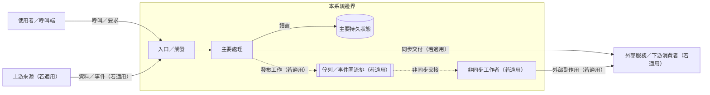
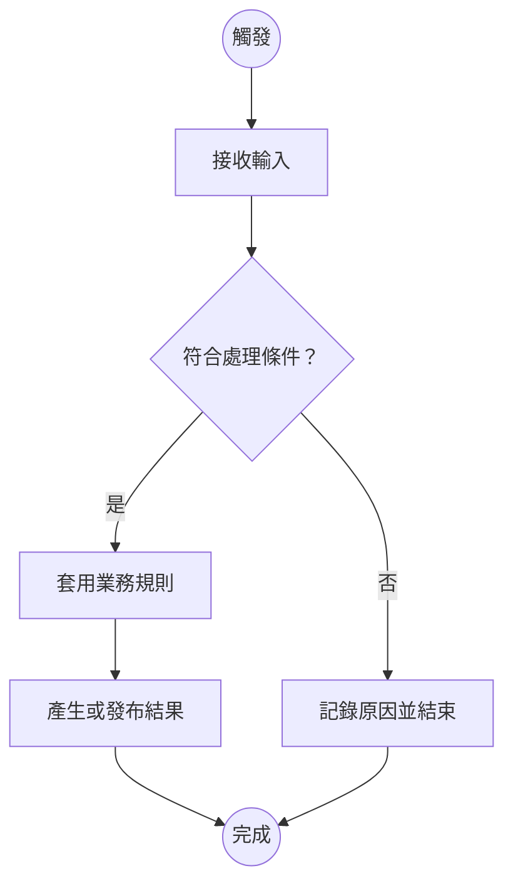

# [系統／專案名稱] 接手指南

> 這份範本是覆蓋底線，不是固定章節規定。先完成「覆蓋盤點」；只有標為不適用／範圍外並說明理由，或已由存在且可存取的正式文件承接時，才移除對應章節。不可默默刪掉相關主題。中大型專案以這頁作入口和索引，再把實質說明拆到互相連結且已建立的 Markdown／筆記頁面。交接預設以指定版本；若未指定則以目前 checkout 的 HEAD 為證據基線，忽略且不提及所有未提交或未追蹤檔案。範例只提示怎麼表達；所有系統事實、數字和操作說明都要由該基線或標明環境與日期的營運證據支持。

> **文件負責人：** [團隊／角色]　**最後驗證：** [日期／revision]　**適用範圍：** [系統、環境、流程]
>
> **閱讀對象：** [剛加入的維護者／值班人員／支援夥伴／跨團隊使用者]
>
> **交付形式：** [Markdown 筆記／Notion 頁面／其他]　**圖檔：** [SVG／PNG 路徑]　**可編輯圖源：** [`.mmd`／`.drawio`／`.svg` 路徑]

## 先從這裡開始

先讓讀者判斷這份指南跟自己的工作有什麼關係，再帶他走完一條真實情境。這一屏只負責定位與導航；元件清單、欄位細節和操作步驟留給後面的章節。

> **系統一句話：** [誰在什麼情況下需要什麼結果？系統會替他完成哪一部分？]
>
> **為什麼重要：** [結果若延遲、錯誤或不可用，誰會受到什麼影響？]
>
> **先從這裡開始：** [接手者現在可以做的低風險第一步；成功時會看到什麼？]
>
> **證據邊界：** [本文件核對到哪個 commit／版本與環境；哪些執行期狀態尚未驗證？]

> **主要資料路徑（適用於資料流程）：** [已查證的來源／觸發] → [關鍵判斷或轉換] → [結果落點／使用者]；[如何看出完成或新鮮]。未確認的排程或 SLA 寫在待確認事項，不要在首屏猜測。

### 讀完後你應該能

- [說明專案目的和系統邊界]
- [追一條主要業務／資料／請求流程]
- [找到需要維護的程式與設定]
- [開始處理一種代表性日常任務或故障]

### 你現在要做什麼？

- 想知道資料為誰產生什麼結果：看[一筆真實情境](#從一個人遇到的情境開始)。
- 想追資料怎麼走、在哪裡分流：看[主流程與責任](#打開系統看哪些部分撐起這條路徑)。
- 想找成功訊號、處理異常或開始維護：看[日常工作](#日常工作如何做如何知道成功)。
- 想查精確的程式、設定或契約：看[實作入口](#要追查或修改時先去哪裡)。

### 中大型專案的多頁入口

小型專案可把適用內容留在本頁。若背景、domain、流程或維護細節太多，請保留本頁的系統說明和閱讀地圖，並把以下適用主題移到已建立的子頁；更新成可點擊的真實路徑。不要在本頁貼滿所有細節，也不要只建立空白標題或檔案清單。

- **業務規則：** [連結] — [哪些定義或規則會改變結果？]
- **主流程與責任：** [連結] — [一筆資料怎麼從來源走到使用者？]
- **接手操作：** [連結] — [如何開始、確認成功和安全升級？]
- **精確參考：** [連結] — [哪些資料字典、API、部署文件或 runbook 適用？]

先完成子頁再更新本索引。每頁標明適用的版本／範圍，能獨立理解其任務，並連回本頁及相關主線。

### 第一條安全上手路徑

1. **確認前提：** [需要的開發環境、權限或文件；權限只連到核准申請途徑。]
2. **從低風險任務開始：** [一項唯讀、本機或可逆的代表性任務；若不適用，說明原因。]
3. **確認預期結果：** [應看到的檔案、狀態、日誌、測試結果或畫面，以及觀察位置。]
4. **知道何時停止：** [會接觸正式環境（production）、敏感資料或不可逆操作的邊界；連到正式維運操作手冊（runbook）或核准流程。]

這段應讓第一次接手的人不需要作者陪同就能找到入口；若環境或操作尚未驗證，明確標示待確認，不填入推測命令。

## 專案背景與責任範圍

- **使用者／消費者：** [誰使用結果或 API？]
- **解決的問題：** [如果沒有此系統，會發生什麼？]
- **成功訊號：** [使用者或營運如何知道結果可用？]
- **系統負責：** [明確範圍]
- **不負責／外部責任：** [上游、下游或其他團隊的邊界]
- **重要相依性：** [外部服務、資料來源、平台或負責團隊]

### 範圍與完整度盤點

狀態請填「正文已說明」、「正式文件承接」、「待確認」或「不適用／範圍外」。承接文件需存在、讀者可存取，並說明何時要看；待確認需列出影響、確認來源／角色和確認前的安全做法。不適用需寫理由。若表格太長，移到本文件的覆蓋附頁並從此處連過去。

| 覆蓋面 | 本系統的能力／問題 | 狀態 | 解答位置或正式來源 | 缺口影響／不適用理由／下一步 |
| --- | --- | --- | --- | --- |
| 使用者、用途與結果影響 | [誰需要什麼結果；錯誤會影響誰] | [狀態] | [章節／可存取連結] | [說明] |
| 能力與接手工作 | [主要功能、流程、排程、工具或維護任務；含明確排除事項] | [狀態] | [能力索引／章節／連結] | [說明] |
| 業務規則與資料契約 | [會改變結果的條件、定義、狀態、欄位或相容性] | [狀態] | [章節／規格／程式證據] | [說明] |
| 端到端流程與重要例外 | [主路徑和影響結果的失敗、延遲、重試等分支] | [狀態] | [章節／流程圖／連結] | [說明] |
| 架構、責任與依賴 | [內外部責任邊界、重要元件及資料去向] | [狀態] | [章節／圖／正式文件] | [說明] |
| 第一天上手 | [環境、設定、必要權限和低風險起步任務] | [狀態] | [章節／入門文件] | [說明] |
| 日常操作與可觀察性 | [成功訊號、日誌／指標、常見診斷和升級途徑] | [狀態] | [章節／runbook／playbook] | [說明] |
| 變更、驗證與復原 | [修改影響、驗證方式、部署責任和可用復原路徑] | [狀態] | [章節／CI／正式操作文件] | [說明] |
| 安全、隱私與資料生命週期 | [權限、敏感資料、保留／刪除、重跑或不可逆限制] | [狀態] | [章節／政策／runbook] | [說明] |
| 維護責任與證據狀態 | [系統／文件負責角色、版本日期、未驗證或待走讀項目] | [狀態] | [本文 metadata／驗收章節] | [說明] |

能力可按責任合併成幾類，不必逐一列 repo 模組。請標出讀者會維護的能力、範圍外能力，以及未知但可能改變交接責任的項目。

### 能力與維護流程索引

列出這份交接涵蓋的主要使用者能力和維護工作；相似項目可按相同責任和維護路徑合併。每列都要讓讀者知道從哪裡開始、成功代表什麼，以及去哪裡查操作細節。

| 能力／維護流程 | 使用者或觸發 | 結果／成功訊號 | 維護入口／負責角色 | 詳細說明／狀態 |
| --- | --- | --- | --- | --- |
| [能力或流程] | [誰在何時使用或啟動] | [可觀察結果] | [程式／操作入口／角色] | [本文章節／正式文件／待確認／範圍外] |

## 從一個人遇到的情境開始

用程式碼儲存庫或正式資料可以支持的真實情境說明系統如何帶來結果。讀者先跟著情境走，再回頭看系統細節。若情境內容只能推論，標示推論並寫出待確認處。

### 先講這次發生什麼

> [某位使用者／同事] 在 [情境] 需要 [結果]。系統會先 [關鍵處理或判斷]，所以他能 [看到的結果]。如果 [重要例外]，他會看到 [可觀察訊號]，接手者可以先 [安全下一步]。

### 跟著這個例子走

依流程先後寫成短段落或步驟，讓讀者一路讀到結果。每一步先回答「發生什麼、為何重要、怎麼確認」，再附能支持該說法的來源；只有短欄位比較才使用表格。

1. **資料如何開始流動？** [使用者動作、來源資料到達或排程觸發；它代表什麼。] [來源]
2. **哪個判斷會改變結果？** [用一筆具體資料說明規則與影響。] [規格／實作證據]
3. **結果交給誰？** [落點、消費者，以及何時可使用或仍未完成。] [來源／可觀察訊號]
4. **沒有照預期完成時呢？** [先看哪個訊號、何時停止、去哪裡找核准的下一步。] [已驗證操作文件／待確認項目]

### 如果資料有不同處理策略

先用白話寫出選擇條件和各路徑會帶來的結果，再分段說明會改變接手者判斷的策略。不要把全量、增量、回補或不同來源的操作交錯在同一串步驟裡。

- **[策略 A]：** [什麼情況適用？主要結果和成功訊號是什麼？]
- **[策略 B]：** [什麼情況適用？跟 A 有何重要差異？]
- **確認依據：** [哪個欄位、狀態、規格或負責角色證明選擇條件？]

### 如果用了概念比喻

- **讀者熟悉的例子：** [生活事物或簡單情境]
- **它對應到系統的哪些行為：** [逐項說明]
- **比喻在哪裡不適用：** [避免讀者以為系統還有不存在的特性]
- **真實機制與證據：** [精確術語、程式／設定位置、可觀察訊號]

不需要為每個概念硬找比喻；若它會令人誤解，就直接用真實例子或流程說明。需要更完整的說明方式時，參考[交接呈現模式庫](../references/presentation-pattern-library.md)。

## 關鍵規則：它保護什麼結果？

用業務語言定義接手者會遇到的詞彙。業務領域（domain）第一次出現時可附英文原詞，之後固定使用同一個中文名稱；陌生縮寫先寫全名。對每項規則說明原因、證據來源和實際影響。

| 名詞／規則 | 白話定義 | 來源或負責角色 | 對系統／維護的影響 |
| --- | --- | --- | --- |
| [名稱] | [代表什麼；必要時舉例] | [核准文件、業務負責角色或資料來源] | [錯了會造成什麼影響] |

### 資料或狀態的關鍵定義

- **一筆資料／一個狀態代表：** [粒度、生命週期或業務含義]
- **唯一可信來源：** [source of truth 和選用原因]
- **時間與時區：** [事件時間、處理時間、結算時點]
- **例外與邊界：** [遲到、重複、空值／零、刪除、身份變更、重跑等適用項目]
- **待業務負責角色確認：** [標記「待確認」，附目前假設、已查過的來源和影響]

## 打開系統看：哪些部分撐起這條路徑？

> **視覺提示：** 先看讀者是否需要理解系統邊界、流程順序、狀態或角色分工，再決定是否加圖。每張圖要回答一個明確問題，旁邊用白話帶讀並連到證據。依[圖型選擇與繪製手冊](../references/diagram-selection.md)挑選；確認最終文件能正常顯示。

若交接要放進 Notion，依[圖解設計與筆記平台交付指南](../references/diagram-design-integration.md)準備 Markdown 正文、可上傳的 SVG／PNG 圖片和唯一可編輯圖源。請把圖片實際插入本節對應位置；不要只留下本機相對路徑或 Mermaid 原始碼，然後把它當成已顯示的架構圖。

### 系統邊界和責任圖（多服務／多元件系統預設保留；單一小型元件可省略）

先依[架構總覽指南](../references/architecture-overview.md)定義範圍、核心責任、重要依賴和主路徑。總覽要在靜止畫面交代範圍內的責任邊界，不逐一列出程式模組；保留重要資料、非同步及信任關係，刪除系統中不存在的選用節點及其箭頭。以下是可改寫的 Mermaid 起手式；圖上連線必須以指定版本的程式、規格或可核對營運證據為準。

**這張圖回答：** [這條情境有哪些部分一起完成結果？哪些責任在系統外？]

**如何讀這張圖：** [先帶讀者看主要路徑，再說明重要支線和責任邊界，最後連到對應入口。]

**證據／未確認事項：** [主要節點、連線、資料路徑和邊界的證據；未確認事項要明確標示。]

**筆記頁上的圖檔：** [插入／連結 `figures/01-system-context.png` 或 `.svg`；在 Notion 建立圖片區塊並上傳檔案。]

**可編輯圖源：** [`diagrams/01-system-context.mmd`／`.drawio`／`.svg`；標明版本或 commit。]

**替代文字：** [用一至兩句說明圖的範圍、主要閱讀方向、核心責任和最重要的邊界。]

### 主要端到端流程／資料流圖（圖比短文更容易說清楚時才保留）

顯示一條真實路徑的來源／觸發、關鍵轉換、判斷、結果與重要失敗出口；不要把所有例外塞進同一張圖。

**這張圖回答：** [剛才的真實情境如何從開始走到結果？]

**如何讀這張圖：** [描述主要路徑、最重要的分支／失敗行為，以及各步驟的實際程式或操作入口。]

**證據／未確認事項：** [分支條件、重試或完成狀態的證據來源；將推論與待負責角色確認項目標明。]

**筆記頁上的圖檔：** [插入／連結 `figures/02-request-flow.png` 或 `.svg`。]

**可編輯圖源：** [`diagrams/02-request-flow.mmd`／`.drawio`／`.svg`；標明版本或 commit。]

**替代文字：** [描述觸發、主要處理、重要分支和最終結果。]

### 視情況增加的圖

- **序列圖：** [哪個重要情境涉及多個服務、非同步交接、timeout、重試或補償？]
- **狀態圖：** [哪個業務物件／工作有重要狀態、合法轉換或終態？]
- **業務資料模型（ERD）：** [哪些實體、粒度、鍵或關係需要先弄懂？]
- **泳道／BPMN：** [哪些步驟跨人員、團隊、系統或核准責任？]
- **部署／網路／identity 圖：** [哪些環境、連線、區域或信任邊界會影響維護？]
- **故障決策圖／標註截圖：** [哪個診斷選擇或 UI 入口適合讓人快速定位？]

### 從白話故事回到實作證據

沿用剛才的情境，指出哪些實作和操作資訊支撐每一步。先說明接手者為何要看該位置，再提供可點回的路徑；只列會改變理解或下一步的重要細節。

| 剛才故事中的哪一步？ | 為什麼接手者需要追到這裡？ | 實際程式、設定或規格 | 狀態與可觀察結果 | 例外與下一步 |
| --- | --- | --- | --- | --- |
| [步驟] | [為什麼做、適用條件] | [可點擊路徑／符號] | [資料變化、日誌、指標或使用者結果] | [會改變處理的分支、已驗證的恢復入口] |

### 元件責任與依賴

只保留支撐核心能力、資料契約或安全維護的責任；可合併同一責任的模組，不逐檔建立註釋表，也不要用目錄樹代替解說。

| 元件 | 負責什麼 | 上游／下游 | 相關程式或設定 |
| --- | --- | --- | --- |
| [元件] | [業務／技術責任] | [來源、消費者] | [可點擊路徑與入口] |

## 要追查或修改時，先去哪裡？

不要只貼目錄樹；挑接手者需要追的少數核心入口，解釋為何要看、它支撐哪個結果或規則。不要把未提交檔案、每個檔案的註釋或純粹依目錄排列的路徑清單放進交接。

| 我要了解／修改…… | 先看…… | 注意…… |
| --- | --- | --- |
| [業務規則或資料定義] | [路徑／符號／文件] | [不變條件、受影響的使用者或資料] |
| [執行入口或排程] | [路徑／設定] | [觸發條件、失敗訊號、成功如何確認] |
| [部署或環境設定] | [路徑／pipeline／環境說明] | [環境邊界、核准的權限途徑] |
| [既有驗證方式] | [測試、CI 或監控定義] | [實際涵蓋範圍、未覆蓋的限制] |

## 日常工作：如何做、如何知道成功？

### 常見任務

| 任務 | 何時做 | 操作文件／程式入口 | 成功如何確認 |
| --- | --- | --- | --- |
| [任務] | [觸發情境] | [runbook 或路徑] | [日誌、指標、資料或結果] |

### 故障時的第一步

| 症狀 | 先看哪裡 | 如何分辨 | 安全的第一步 | 恢復確認／升級 |
| --- | --- | --- | --- | --- |
| [症狀] | [監控儀表板、記錄或維運操作手冊] | [已驗證訊號或判斷條件] | [已核准、可逆的處置；否則連到操作手冊] | [恢復訊號和負責角色／正式支援途徑] |

**注意：** [明確說出任何會造成重複寫入、資料遺失或無法安全回復的動作；引用正式維運操作手冊，不自行補正式環境指令。]

### 修改前影響檢查

- [ ] 對應的業務規則或資料粒度是否改變？
- [ ] 上游、下游、API／schema 相容性、排程或權限會受影響嗎？
- [ ] 是否涉及歷史資料、重跑、回補、重複處理或對帳？
- [ ] 如何確認結果、觀察告警，必要時怎麼安全復原？

## 已知限制、風險與未解問題

| 待確認的問題 | 已查證的部分／目前假設 | 為何重要、可能影響 | 確認方式與負責角色 | 確認前的安全做法 |
| --- | --- | --- | --- | --- |
| [問題；標明事實、推論或未知] | [檔案、符號、規格、執行環境或已詢問來源] | [使用者／營運／技術影響] | [要查的正式來源或負責角色] | [避免猜測的保守作法] |

## 交接驗收與文件維護

- **覆蓋盤點：** [所有適用列都有狀態和回答位置；空白已補齊；不適用／範圍外都有理由；承接文件存在且可存取]
- **流程完整度：** [代表流程的觸發、輸入、判斷、結果、成功訊號、重要例外、觀察點和安全下一步都能追完]
- **證據與連結：** [重要事實有來源／版本／日期；推論與未知有標示；目錄、章節和延伸頁連結可用]
- **安全上手：** [起步前提清楚；高風險操作指向已驗證的正式操作文件與授權邊界]
- **非作者走讀：** [接手者是否能只照文件追完情境並完成低風險任務；日期、卡點與修正；未安排時標示尚未驗證]
- **交付狀態：** [已走讀可標示驗收完成；未走讀或仍有會影響安全接手的未知時，明確標示尚未驗收／待確認]
- **仍需安排的搭檔觀摩或操作演練：** [項目／負責角色]
- **文件維護負責角色：** [團隊／角色]
- **觸發更新的變更：** [例如業務規則、資料 schema、主要元件、操作流程或告警變更]
- **待確認清單：** [問題、目前假設、要找的角色、預計確認時點]

## 參考連結

- [架構／ADR]
- [業務定義／維運操作手冊／調查手冊]
- [部署／告警／事故回顧]
- [相關程式路徑與維護指南]
