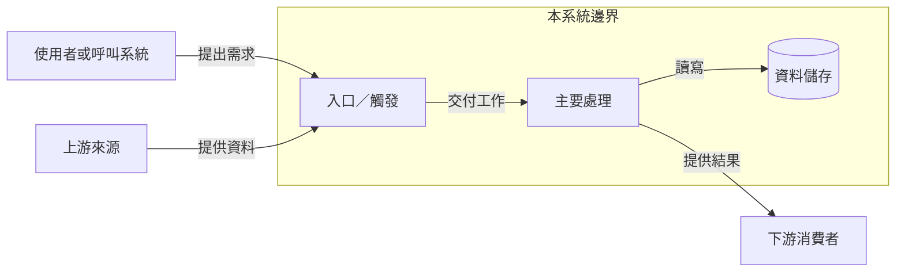
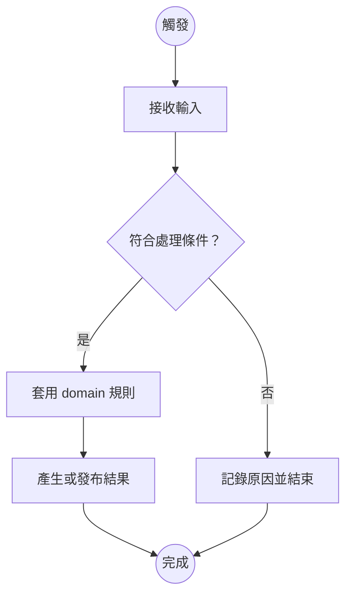
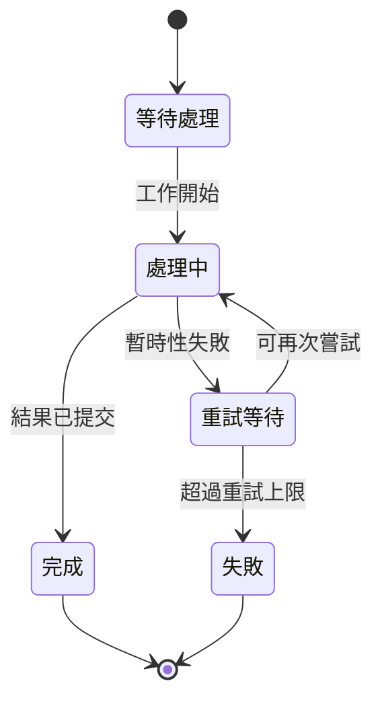

# 工程交接的圖型選擇與繪製

先問「接手者要在幾秒內看懂什麼？」再決定圖型。圖是說明內容的一部分，不是裝飾；當資訊主要在描述關係、順序、分支、狀態、責任、位置或比例時，先考慮圖，而不是把它塞進段落或寬表。圖不是一律比文字快：相關、易讀並緊貼解說的圖能幫助讀者組織流程和關係；無關圖片會增加視覺負擔。實驗研究也發現，和學習目標相關的圖與純裝飾圖片效果不同，因此每張圖都要能回答具體問題。[相關研究](https://www.sciencedirect.com/science/article/pii/S0747563212000921)

## 完整交接的視覺基線

每份完整交接先規劃兩張核心視圖：

1. **系統脈絡／架構圖**：本系統、使用者、上游／下游、主要責任邊界和外部依賴。
2. **主要端到端流程／資料流圖**：一條真實、有代表性的業務或技術路徑，從觸發／來源一路到結果，包含關鍵分支或失敗出口。

架構總覽要先定義範圍，再用一條主路徑和少量必要支線呈現範圍內的完整責任；精簡不等於省略關鍵資料、非同步或信任關係。細節見[架構總覽指南](architecture-overview.md)。

然後逐章做視覺掃描。狀態轉換、服務互動順序、跨團隊交接、domain 資料關係、部署邊界、故障決策或 UI 操作若不直觀，就另加對應圖。不要把所有資訊硬塞進兩張基線圖，也不要為了湊數重畫相同資訊。只有極簡系統才可合併視圖；要確保兩個核心問題仍能一眼回答。

| 讀者要快速理解…… | 優先使用 | 何時特別有用 | 不要拿它代替…… |
| --- | --- | --- | --- |
| 系統的目的、範圍和外部關係 | C4 系統脈絡圖 | 新人需要知道誰使用系統、哪些依賴在邊界外 | 元件內部設計 |
| 主要執行單元和責任 | C4 container／服務架構圖 | 需要從業務系統縮放到可部署服務、工作、資料庫、佇列 | 單一請求的先後順序 |
| 某個服務內部的核心模組 | 元件圖 | 維護範圍限於一個服務或模組，且責任分拆影響改動 | 全系統總覽；沒要改就別畫 code-level 全景 |
| 資料來源、轉換、儲存、輸出和信任邊界 | 資料流圖（DFD／lineage） | ETL、事件平台、報表、個資流向、批次與串流差異 | 業務條件的完整判斷流程 |
| 工作如何開始、判斷、成功或失敗 | 流程圖／活動圖 | 有分支、重試、人工步驟、錯誤出口或操作選擇 | 跨多角色的責任分界；那種情況加泳道 |
| 多個團隊／角色在哪裡交接 | 泳道圖；規則複雜時用 BPMN | 審批、支援升級、部署交接、跨部門業務流程 | 系統部署位置或資料實體結構 |
| 一個情境中服務如何依序互動 | 序列圖／C4 dynamic diagram | API 呼叫、非同步事件、timeout、重試、補償或故障分析 | 靜態服務全貌；只畫最值得說明的一個情境 |
| 業務物件或工作有哪些合法狀態 | 狀態圖 | 生命週期、狀態轉換條件、終態、重入或補償處理 | 一般線性流程；若只是順序步驟，用流程圖即可 |
| 實體的定義、粒度、鍵與關係 | domain model／ERD | 交接資料庫、分析表、事件 schema 或業務概念 | 每張表每個欄位的完整字典；細節另用 reference |
| 元件部署在哪些環境、網路或信任區 | 部署圖／網路圖／identity flow | 權限、連線、區域、私網、故障域或安全交接 | 業務流程或資料生命週期 |
| 使用者如何完成任務、在哪裡卡住 | user flow／journey／標註截圖 | 有 UI、入口網站、內部工具或需照畫面操作時 | 後端元件呼叫順序 |
| 故障時下一步要看哪裡 | 診斷決策樹／故障定位圖 | 症狀有多種可能原因，或要依觀測結果選擇安全動作 | 正式 runbook 的完整命令和執行細節 |
| 多個選項如何按條件取捨 | 決策樹；大量條件組合用決策表 | 路由規則、支援分流、產品行為或選擇操作 | 元件關係圖 |
| 概念如何分類、包含或互相支援 | 分層圖／概念圖／mind map | 幫新接手者先建立陌生 domain 的詞彙和範圍 | 精準流程、資料量或執行順序 |
| 風險／方案在兩個重要尺度上的位置 | 有明確軸與定義的 2×2 矩陣 | 方案定位、風險影響或優先順序有兩個可比較維度時 | 任意把複雜情況壓成四格；這時用判準和決策表 |
| 變更影響哪些上下游 | 相依圖／影響範圍圖 | 共用資料、函式或服務有多個消費者 | 大型未分層的全 repo 依賴網 |
| 工作或事件如何隨時間變化 | 時間軸／Gantt | 遷移、版本支援、排程、切換窗口和責任交接 | 流程分支和控制邏輯 |
| 每個階段流量或資料量如何分配 | Sankey／帶數值的流量圖 | 轉換率、資料損耗、流量比例是理解重點時 | 只想表達步驟順序的流程圖 |

C4 的系統脈絡和 container 圖通常足以交代大多數團隊的高層結構；component、code 或 dynamic 圖只在其層次提供額外理解時才加。UML 提供結構、行為和互動等不同視角；BPMN 適合需要標準化表示事件、閘道和多角色業務流程的情境，但不是資料模型或系統架構圖的替代品。

## 選擇繪製方式

- **Mermaid**：簡單且要跟 Markdown 同版控的流程、序列、狀態、ERD、使用者旅程或時間線。優點是圖源可 review、易更新；複雜自動佈局可能交叉或擠壓，請改用適合的工具，不要為了維持純文字而犧牲可讀性。
- **draw.io／Draw.io**：需精確佈局、跨角色泳道、網路拓樸、正式架構圖或視覺調整時。保留 `.drawio` 原始檔，並將 SVG／PNG 實際嵌入文件，避免讀者只看到來源連結。
- **UML／BPMN**：當讀者需要共享正式符號語意、流程複雜度足以值得使用時採用；簡單流程不要套一整套標準符號增加閱讀成本。
- **互動式架構圖**：當圖需要分層探索、連到 repository／runbook 或展示追蹤路徑，且環境有合適圖表工具時可採用；仍需在文件放一張可直接理解的靜態摘要圖。
- 若環境已安裝 `$archify`，而讀者確實需要可探索或可追蹤的架構圖，可用它製作互動式視圖；不要把每一張簡單流程圖都變成獨立互動頁，也不要省略交接文件內的靜態摘要圖。
- **標註截圖**：當任務與特定 UI、儀表板或設定頁有關時，用實際介面截圖標出位置、步驟和預期訊號。遮蔽個資、token、客戶資料和內部秘密，附上版本／環境與截圖日期。

架構事實要用可編輯的結構化圖源表達，並依 repository 證據核對節點、箭頭和標籤。不要用 AI 生成的裝飾性插畫冒充系統架構；示意插畫只能說明抽象概念，必須明確標成示意。若目標文件不支援 Mermaid，將圖輸出成向量或點陣圖片並實際嵌入，同時保留來源檔。

## 繪製步驟

1. 用一句話寫下圖要回答的問題與目標讀者。若說不出問題，先不要畫。
2. 決定抽象層次和邊界；每一張圖維持同一層，不要混放人物、雲端服務、函式、資料欄位和 team 名稱。
3. 先根據 repository、規格或 owner 確認列出事實，再排版。推論和待確認內容要標記，不可默默畫成確定事實。
4. 選一個閱讀方向（常見為左到右代表資料／請求向前、上到下代表決策或步驟），減少回折線和交叉線；跨責任或信任邊界要可見。
5. 節點用短的業務語言命名，必要時補技術名稱。每條箭頭表達一種關係，標上資料／事件／觸發／條件；同步、非同步、回覆、失敗和重試不要靠猜。
6. 使用一致的形狀、線型、顏色和命名。顏色只作輔助，另用形狀、線型或文字標籤區分；保持對比並提供簡短圖例。
7. 刪掉對當前問題沒有幫助的節點；拆分長圖、重複流程或不同抽象層。加標題、範圍、必要的更新日期／版本和來源。
8. 在實際文件版面檢查渲染尺寸、標籤可讀性、連線方向、圖例、色彩對比和換頁裁切。圖旁用數句白話帶讀一條主路徑，並連到實際程式入口；加上描述圖的 alt text，讓無法讀圖的人仍能掌握主要關係。

## 先寫語義草稿，再產生圖

把圖當成一份精簡的關係規格，不要一開始就調顏色或手畫座標。這份草稿也能幫忙從 repository 證據核對圖上事實：

1. **讀者問題**：這張圖要讓誰回答什麼問題？
2. **範圍與層次**：本圖包含哪些責任邊界？節點是系統、服務、工作還是 domain 概念？同一張圖維持同一層。
3. **節點**：每個節點代表什麼責任或狀態？用讀者認得的名稱，必要時附 repository 中的真實名稱。
4. **關係**：每條箭頭代表呼叫、資料、事件、依賴、控制轉移或人工交接中的哪一種？標明方向、條件、同步／非同步，以及必要的資料或事件名稱。
5. **路徑與例外**：標出主要成功路徑，再列出會改變接手者動作的拒絕、逾時、重試、回補或失敗出口。不要把所有錯誤碼塞進主圖。
6. **證據與不確定性**：為重要節點和邊保留檔案、符號、設定或規格來源；未確認的責任或行為在圖說和圖上明確標記。

完成草稿後，使用 repository 現有的圖表工具和慣例輸出。若工具能從關係描述自動排版，就提供節點、群組和連線，不要自行猜測 SVG 座標。若輸出工具支援元件語法檢查，先修正行號診斷，再檢查語義；解析器只能發現格式問題，不能證明架構事實正確。圖表出錯時，診斷訊息應能定位到圖源中的行或元件，方便局部修正。

「Answer me with HTML」示範了這種分工：作者提供短 Markdown 草稿與語義化流程／序列元件，CLI 負責自動排版、渲染與寫作檢查。可移植的優點是作者把心力放在內容和關係，並能快速迭代；這不代表 TOI 文件必須改成該專案的 HTML 格式或安裝它的 CLI。[專案說明](https://github.com/QingYunA/answer-me-with-html)｜[架構範例](https://github.com/QingYunA/answer-me-with-html/blob/main/examples/architecture.md)

## 流程圖與架構圖的驗收

- **先驗語義**：每個節點是否有清楚責任？每條箭頭是否能用一句話解釋？架構總覽是否在靜止畫面就能回答範圍內的主要結構問題，並只表達該層的責任與邊界，沒有混進另一層的逐步控制流程？
- **再驗路徑**：從觸發走到成功結果是否連續？決策的每個出口是否有條件標籤？重試是否有上限或終止方式？失敗後留下什麼狀態是否符合程式和操作證據？
- **最後驗版面**：在目標文件的正常閱讀寬度及窄視窗下檢查；確認沒有裁切或過小的文字、飄在節點外的箭頭、交疊標籤、難以追蹤的回折線，以及只靠顏色區分的資訊。縮圖仍看不清時，拆圖或簡化標籤。
- **驗證可追溯性**：實際渲染圖要與版控中的可編輯圖源一致。圖說交代主路徑和維護者下一步；可及性文字說明圖的範圍、順序或關係。

語法檢查、渲染成功和人工審圖各自回答不同問題，三者不能互相代替。沒有合適 renderer 時，保留可編輯圖源，輸出並實際檢視目標格式支援的圖片。

## Mermaid 起手式

用白話標籤描述圖，替換所有方括號範例並刪除不適用節點。這些是內容骨架，不是固定樣式。

### 系統脈絡／架構

### 主要端到端流程

### 狀態生命週期

若文件平台不支援 Mermaid 的 `stateDiagram-v2`，使用支援的狀態圖工具輸出 SVG／PNG，不要把未渲染的原始碼當成已交付的圖片。

## 參考資料

- [Microsoft Azure Well-Architected: Design diagrams](https://learn.microsoft.com/en-us/azure/well-architected/architect-role/design-diagrams)
- [Microsoft Azure Well-Architected: Identify and rate flows](https://learn.microsoft.com/en-us/azure/well-architected/reliability/identify-flows)
- [C4 model: Diagrams](https://c4model.com/diagrams)
- [C4 model: Dynamic diagrams](https://c4model.com/diagrams/dynamic)
- [OMG: What is UML?](https://www.omg.org/uml/what-is-uml.htm)
- [OMG BPMN 2.0.2 specification](https://www.omg.org/spec/BPMN/2.0.2/PDF/)
- [Mermaid diagram catalog](https://mermaid.js.org/intro/)
- [Mermaid flowchart syntax](https://mermaid.js.org/syntax/flowchart.html)
- [Mermaid state diagram syntax](https://mermaid.js.org/syntax/stateDiagram.html)
- [draw.io: Flowcharts with swimlanes](https://www.drawio.com/docs/diagram-types/swimlane-diagrams/)
- [draw.io: Technical diagrams and editable exports](https://www.drawio.com/docs/getting-started/technical-diagrams/)
- [Mayer et al.: When graphics improve liking but not learning from online lessons](https://www.sciencedirect.com/science/article/pii/S0747563212000921)
- [Answer me with HTML: content-first drafts, diagram components, auto-layout and writing checks](https://github.com/QingYunA/answer-me-with-html)
